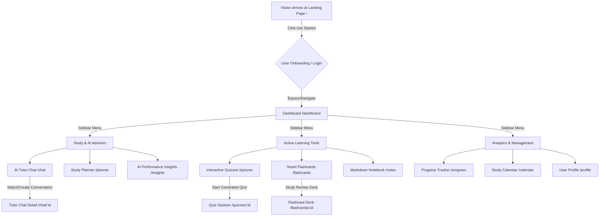
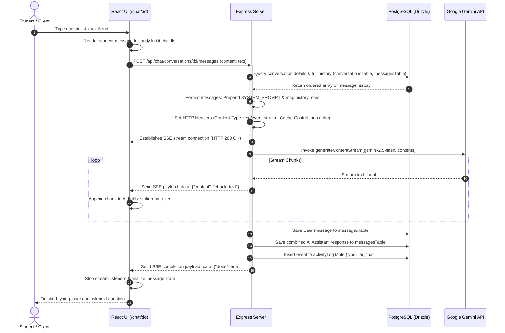
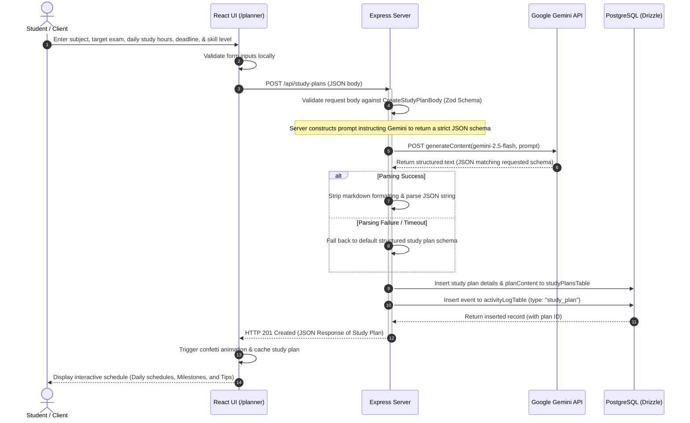
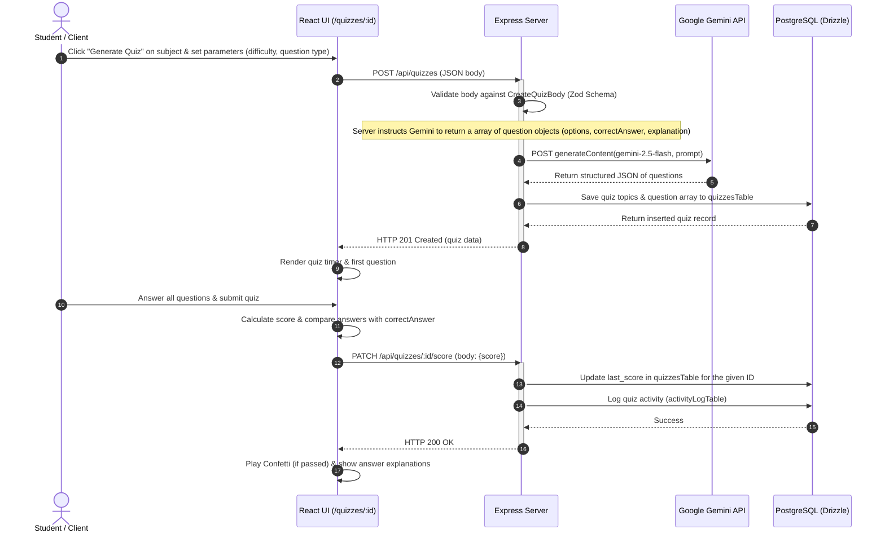

# LearnGenie AI — Detailed System Workflows

This document outlines the detailed user journeys, system architectures, and sequence diagrams for the core features of **LearnGenie AI**.

---

## 1. User Journey & Feature Navigation Flow

This flowchart illustrates how a student interacts with the LearnGenie application, from landing on the homepage to navigating different dashboard modules.

---

## 2. Technical Sequence: AI Tutor Chat with SSE Streaming

This sequence diagram illustrates the lifecycle of a real-time conversational exchange with the LearnGenie AI tutor, utilizing **Server-Sent Events (SSE)** for latency-free streaming.

---

## 3. Server-Client Boundary: Study Plan Generation Workflow

This diagram outlines how a personalized study plan is requested, generated by AI in a strict structured format, persisted in the database, and rendered to the client.

---

## 4. Technical Sequence: AI Quiz Generation & Performance Review

This sequence illustrates the process of generating custom quizzes, capturing student answers, and persisting quiz performance scores.

